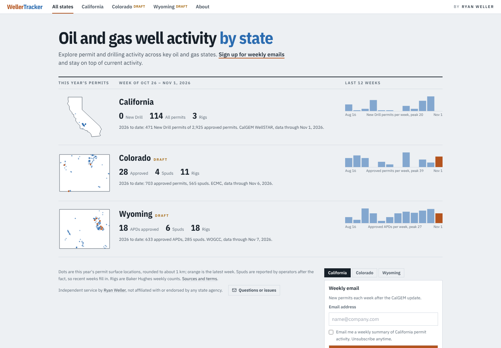
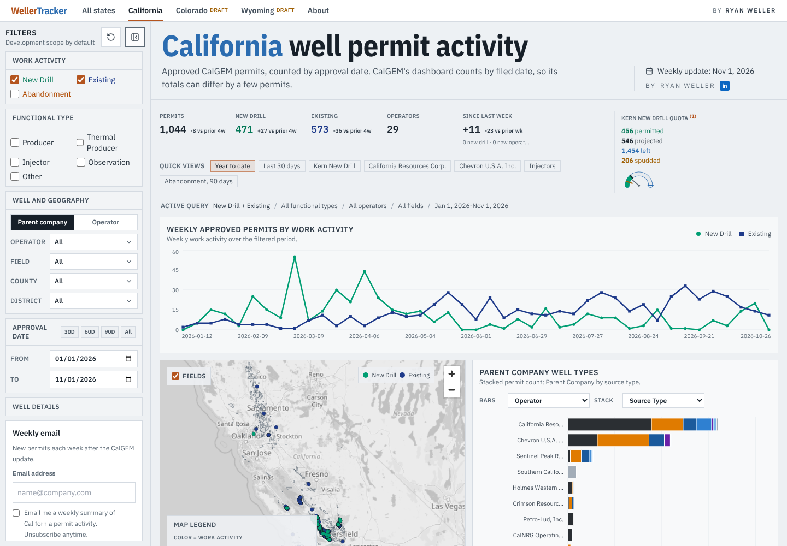
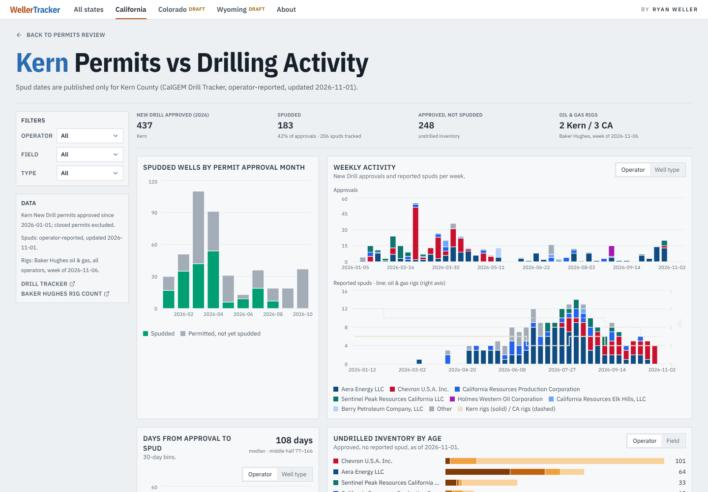
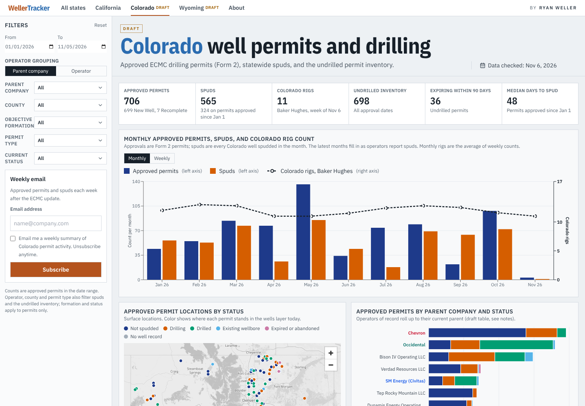
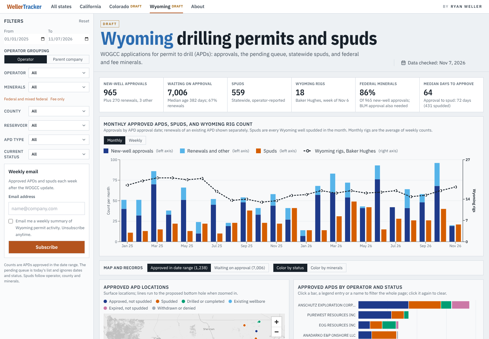

# WellerTracker: oil and gas well permit activity by state

[WellerTracker](https://permits.ryweller.com) tracks approved oil and gas well permits and drilling activity in California, Colorado, and Wyoming from public state regulator data, updated weekly. Colorado and Wyoming are drafts.

It shows who is permitting wells, what work is being permitted, where activity is concentrated, how permits turn into spuds, and links each record back to the state's official source.

## Pages

| Path | Page |
|---|---|
| `/` | States overview: this year's permits, the latest week, and a 12-week trend per state |
| `/ca/` | California permits (CalGEM WellSTAR) |
| `/ca/drilling/` | Kern County permits vs drilling activity |
| `/ca/prod/` | California oil decline and Kern New Drill quota sensitivity model |
| `/co/` | Colorado permits and spuds (ECMC), draft |
| `/wy/` | Wyoming APDs and spuds (WOGCC), draft |
| `/about/` | Sources, methods, and terms |

Old California links (`/`, `/?operator=…`, `/drilling`, `/prod`, `/about-methodology`) redirect to the same view under `/ca`.



### California



- Approved permit activity by operator or parent company, field, county, district, functional well type, and work activity, counted by approval date.
- Searchable multi-select filters that list only values with permits under the other active filters.
- Quick views, a "since last week" KPI, and the Kern County SB 237 New Drill quota gauge.
- Default development scope: New Drill and Existing work, with Abandonment available but off by default.
- Weekly permits by work activity, a map over CalGEM field boundaries (symbol shape is functional well type, color is work activity), and parent company well types.
- Shareable filter URLs, a permit record table with CSV export, pool names, and WellSTAR and WellFinder links using normalized API numbers.



`/ca/drilling/`: spudded wells by approval month, approval-to-spud lag, weekly approvals and spuds with rig counts, undrilled inventory by age, and operator detail. Spud dates are operator-reported and published only for Kern County.

### Colorado (draft)



Approved Form 2 permits, statewide spuds, the undrilled permit inventory and expirations, monthly permits vs spuds vs the Colorado rig count, a status map, and permits by parent company.

### Wyoming (draft)



APD approvals and renewals, the pending queue, statewide spuds, federal vs fee minerals, monthly APDs vs spuds vs the Wyoming rig count, a status or minerals map, and APDs by operator.

### Across the site

- A weekly email per state (Cloudflare Worker in `worker/`).
- An owner-only admin page with visitors, subscribers, ingest runs, and the backlog.
- Pages readable without JavaScript: the build stamps the latest weekly numbers into each route's static HTML (`<noscript>`), JSON-LD dataset dates, `sitemap.xml`, and `llms.txt`.

## Data Sources

All sources are public; no credentials are needed.

California:

- Permits: [WellSTAR Notices layer 1](https://gis.conservation.ca.gov/server/rest/services/WellSTAR/Notices/MapServer/1)
- Wells: [WellSTAR Wells layer 0](https://gis.conservation.ca.gov/server/rest/services/WellSTAR/Wells/MapServer/0)
- Field boundaries: [CalGEM Admin Bounds layer 0](https://gis.conservation.ca.gov/server/rest/services/CalGEM/Admin_Bounds/MapServer/0)
- WellFinder context: [CalGEM Well Finder](https://conservation.ca.gov/calgem/Pages/Wellfinder.aspx)
- Pool names: [CalGEM monthly wells CSV](https://wellstar-public.conservation.ca.gov/General/PublicDownloads/Index) (`<year>CaliforniaOilAndGasWells.csv`)
- Kern spud dates: [CalGEM Central District Drill Tracker](https://www.conservation.ca.gov/calgem/Documents/Permits/Central%20District%20Drill%20Tracker.xlsx) (operator-reported)

Colorado (details in [docs/colorado_plan.md](docs/colorado_plan.md)):

- Permits: [ECMC approved Permits to Drill (Form 2)](https://ecmc.state.co.us/permits/?t=1)
- Undrilled permits and wells with spud dates: [ECMC GIS downloads](https://ecmc.state.co.us/data2.html#/downloads) (`PERMITS_SHP.ZIP`, `WELLS_SHP.ZIP`)

Wyoming (details in [docs/wyoming_plan.md](docs/wyoming_plan.md)):

- APDs, wells, and spuds: [WOGCC Data Explorer](https://dataexplorer.wogcc.wyo.gov/) (Standard APD report and GeoServer WFS)

All states:

- Rig counts: [Baker Hughes North America Rig Count Report](https://rigcount.bakerhughes.com/na-rig-count) (weekly; oil and gas rigs, geothermal excluded)

## Project Status

California is live; Colorado and Wyoming are drafts. The stack:

- React + Vite + TypeScript + Tailwind frontend.
- A repo-backed data store: each state's weekly ingest writes JSON Lines under `data/` (California), `data/co/`, and `data/wy/` and commits them. No database or secrets are needed for the site.
- Python ingest scripts (`backend/`) for CalGEM ArcGIS REST services, ECMC downloads, and the WOGCC Data Explorer.
- A static data snapshot: the build (`frontend/scripts/snapshot-*.mjs`) joins the stored permits to their wells and bakes them with fields, the Drill Tracker, pool names, and rig counts into `public/data/*.json`. Supplementary sources are optional; if one fails, that dataset is dropped and the build continues. Results are logged in `data/meta.json` under `sources`.
- GitHub Pages hosting at `permits.ryweller.com`, redeployed after each successful weekly ingest.
- A Cloudflare Worker at `permits-api.ryweller.com` for email sign-up, weekly digests, visit counts, and the admin page (see [worker/README.md](worker/README.md)).

Depth and completion interval data are intentionally treated as a future enrichment step. V1 stores placeholder depth/target fields and links users to the official WellSTAR detail page when those values are not available in the public ArcGIS layers.

See [ROADMAP.md](ROADMAP.md) for the product direction and [BACKLOG.md](BACKLOG.md) for the working to-do list.

## Repository Layout

```text
backend/                 Python ingest scripts that write the data store
data/                    California data store: permits, matched wells, fields, ingest runs (JSON Lines)
data/co/, data/wy/       Colorado and Wyoming data stores
frontend/                React/Vite app
frontend/scripts/        Build-time data snapshot, source fetchers, route pages
docs/                    Product, architecture, and data notes
tests/                   Python ingest/normalization tests
worker/                  Cloudflare Worker: email sign-up, weekly digest, visit analytics, admin page
.github/workflows/       Weekly ingest automation
```

## Run The App Locally

```bash
cd frontend
npm install
npm run snapshot
npm run dev
```

Open the local Vite URL, usually `http://localhost:5173` or `http://localhost:5174`. `npm run snapshot` builds `public/data/` from the committed `data/` store; re-run it after an ingest.

To test the rig count without network access to Baker Hughes, point the snapshot at a downloaded report:

```bash
BAKER_HUGHES_RIGCOUNT_FILE=~/Downloads/North_America_Rig_Count_Report.xlsx npm run snapshot
```

### Preview builds

A preview build runs from any subfolder and adds a small navigation bar for the secondary pages:

```bash
VITE_PREVIEW=1 npx vite build --base ./ --outDir /tmp/preview
```

Routes also work as hash links (`#/ca`, `#/ca/drilling`, `#/co`, `#/wy`) for hosts that can't serve custom paths.

## Run The Ingest

```bash
python -m venv .venv
source .venv/bin/activate
pip install -r backend/requirements.txt
python backend/run_ingest.py         # California (CalGEM)
python backend/ingest_colorado.py    # Colorado (ECMC)
python backend/ingest_wyoming.py     # Wyoming (WOGCC); keep runs light, its firewall blocks heavy fetching
```

The California ingest is described below; see the Colorado and Wyoming plans in `docs/` for theirs.

The ingest validates expected source fields, pages ArcGIS REST responses, normalizes API numbers, and deduplicates permit records. It then writes `data/`:

- `permits.jsonl`: merged by `source_key`. Permits that drop out of the CalGEM layer stay in the history.
- `wells.jsonl`: only the wells that permits reference (the full layer is ~240k wells), merged by `api_10`.
- `fields.jsonl`: field boundaries, replaced each run.
- `etl_runs.jsonl`: the latest ingest runs, newest first.

## Tests

```bash
pytest tests
(cd worker && npm test)
cd frontend
npm test
npm run lint
npm run build
```

## GitHub Actions

No repository secrets are required.

Workflows:

- `weekly-ingest.yml`, `weekly-co-ingest.yml`, `weekly-wy-ingest.yml`: Monday ingests for CalGEM, ECMC, and WOGCC; each commits its data to `main` and triggers a redeploy when it succeeds.
- `ci.yml`: Worker and frontend tests on pull requests and pushes to `main`.
- `deploy.yml`: builds the snapshot and site, then publishes to GitHub Pages. It runs on pushes to `main` and after each successful ingest.
- `keepalive.yml`: a Thursday check that fails if the last recorded ingest in `data/etl_runs.jsonl` is more than 9 days old.
- `keep-undead.yml`: re-enables the scheduled workflows twice a month, because GitHub disables them after 60 days without repository activity.

## GitHub Pages Deployment

This repo is configured to deploy the Vite app with GitHub Actions from `.github/workflows/deploy.yml`.

- GitHub Pages source: `GitHub Actions`
- Build command: `npm run build` from `frontend`
- Published artifact: `frontend/dist`, including a real `index.html` per route (`/ca/`, `/ca/drilling/`, `/co/`, `/wy/`, …) with its own title and social card, written by `frontend/scripts/route-pages.mjs`
- Custom domain file: `frontend/public/CNAME`
- Custom domain: `permits.ryweller.com`

For the DNS record, point the `permits` subdomain at GitHub Pages:

```text
Type: CNAME
Name: permits
Target: rockpyer.github.io
Proxy: DNS only while GitHub issues the certificate
```

After GitHub Pages shows the DNS check passing and the certificate is issued, enable `Enforce HTTPS`.

## Design Direction

- Keep the interface dense, modern, and useful for repeat analysis.
- Keep the map and permit table as the primary workspace.
- Keep filters compact and collapsible.
- Avoid over-interpreting permit types without depth, formation, pool, and completion context.
- Reserve future field narratives for when richer geologic and wellbore data are available.

## License

Copyright © 2025–2026 Ryan Weller. All rights reserved; see [LICENSE.md](LICENSE.md). Versions before November 9, 2026 were released under CC BY-SA 4.0.
