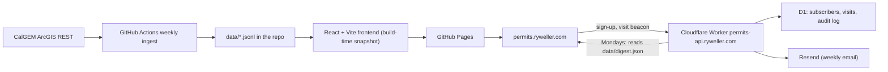

# Architecture

## V1 Shape

## Backend

The backend is a set of Python ingest scripts, not a long-running service. Scripts validate source fields, paginate ArcGIS REST responses, normalize API numbers, dedupe permit records, generate official links, and merge the results into JSON Lines files under `data/`, which the workflow commits. Permits and wells are merged by key so records that leave the CalGEM layers are kept; only wells referenced by a permit are stored.

## Frontend

The build (`frontend/scripts/snapshot-data.mjs`) joins each stored permit to its well, with well attributes taking precedence, and writes static JSON under `public/data/`. The app loads those files and performs V1 filtering client-side.

The frontend intentionally keeps layout constraints local:

- The map component has a bounded responsive height so wide table layouts do not force excessive map height.
- Map points are rendered as individual clickable markers with a legend. Canvas clusters are disabled for now.
- Map controls support coloring by Permit Scope, Well Type, Operator, or Date. V1 uses one clean OSM basemap.
- Date filtering and trend calculations use `notice_date_determination` as the approval/determination date, falling back to `notice_dated` only if needed. The default query starts on 2026-01-01, but the date picker can reach back to the earliest loaded determination date.
- Weekly trend, current-year operator/field stacked charts, and operator permit-rate trend are computed client-side from the loaded permit activity rows.

## Email list and analytics

`worker/` is a Cloudflare Worker at `permits-api.ryweller.com` for what a static site can't do: the weekly-update sign-up
(double opt-in), the weekly digest email, anonymous visit analytics, and the admin page (`/admin`, user Neptune). The
snapshot writes `public/data/digest.json` (`frontend/scripts/digest.mjs`), which the Worker reads each Monday after the
ingest and redeploy. See [worker/README.md](../worker/README.md) for the API, security model and setup.

## Security

The site and ingest have no runtime credentials: the ingest reads public ArcGIS services and pushes with the workflow's
`GITHUB_TOKEN`. The Worker's secrets (`ADMIN_PW`, `SIGNING_KEY`, `RESEND_API_KEY`) live only in Cloudflare.

## Deployment

GitHub Pages serves static files from `frontend/dist` through the custom domain `permits.ryweller.com`. GitHub Actions refreshes the data store weekly and redeploys. No Render/Railway/FastAPI service is required for V1.
